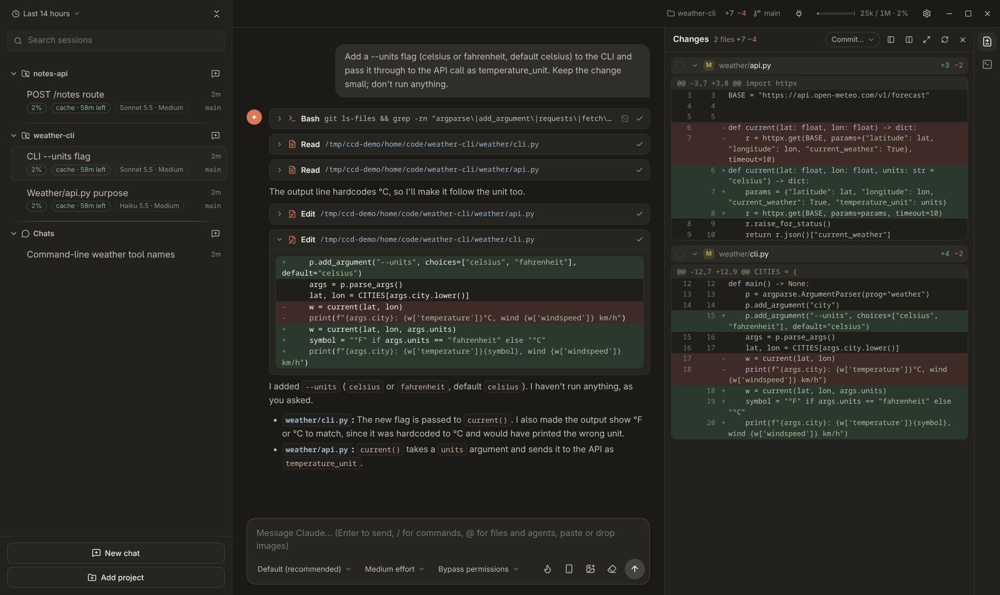
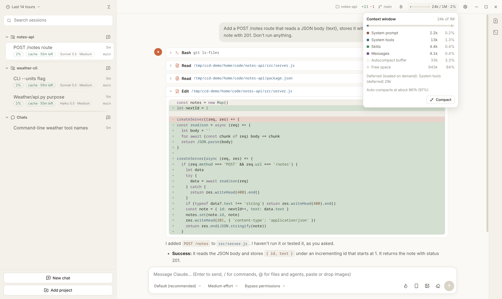

# Hearth

**Keep your Claude Code sessions warm.** A desktop app for [Claude Code](https://docs.claude.com/en/docs/claude-code), built for Linux first (macOS and Windows builds too).
It runs on the Claude Agent SDK and your existing Claude Code login: no API key, same subscription, same
settings, same sessions as the CLI.



> Unofficial community project, not affiliated with or endorsed by Anthropic.

## Why

Claude Code's desktop tab only exists in the Claude desktop app, which has no official Linux build. This app gives you
that experience on Linux, plus a few things aimed at people who keep many sessions going at once:

- **Every session on the machine in one sidebar**, grouped by project, with the context used, how long the prompt
  cache stays warm, model and effort, and git branch at a glance. Busy, finished-unseen and waiting-for-you dots.
- **Keep the prompt cache warm** for chats you'll come back to, and a warning before you send into a cold cache
  (with a one-click "clear context & send").
- **Review and steer changes without leaving the chat**: git changes panel with syntax-highlighted unified or
  side-by-side diffs, stage / discard per file or hunk, and line comments that go back to Claude as one message.
- **Built-in terminal** per project, worktree chats, background task pills, and a live view of each subagent.
- **Continue from your phone**: Remote Control (claude.ai/code and the Claude mobile app), or the companion
  Android app over your LAN / Tailscale.

## Features

- **Sessions**: lists everything in `~/.claude/projects`, refreshes live, search, time window, pin / rename /
  reorder projects, per-project default model and effort. Resume, fork, `/clear` in place, delete.
- **Chat**: streaming Markdown with highlighted code, thinking summaries, tool cards (Bash output, Edit diffs,
  Write content, todos, web search sources), images by paste or drop, message queue while Claude works, find
  in chat, prompt history.
- **Control**: permission, question and plan cards (`AskUserQuestion`, plan mode with Shift+Tab), model / effort /
  permission mode per session, `/` command picker, `@` picker for files and subagents, stop, move a running
  command to the background.
- **Context and usage**: context meter by category with Compact, per-turn token and cache stats, plan rate limits
  (5-hour and weekly) in the top bar.
- **Projects**: git changes panel, integrated terminal (Ctrl+`), worktree chats (`.claude/worktrees/<name>`),
  open in your editor or terminal, MCP server status with enable / reconnect.
- **General chats**: claude.ai-style chats with web search and fetch, no project folder needed.
- **Workflow designer**: visual editor for Claude Code saved workflows (`.claude/workflows/*.js`), see
  [docs/workflows.md](docs/workflows.md).
- **Phone**: Remote Control per chat, and a paired Android companion that shares the desktop's live sessions
  ([docs/mobile.md](docs/mobile.md)).
- **Desktop**: notifications when a turn ends or Claude needs you, tray icon (closing hides to tray), light / dark /
  system theme, keyboard-driven sidebar.



## Install

You need the Claude Code CLI logged in once (`claude` works in a terminal). The app brings its own copy of the
Claude Code binary through the Agent SDK.

Download a build from [Releases](https://github.com/zmilojevic/hearth/releases):

- **Arch / Manjaro / CachyOS**: the `hearth-bin` package is not on the AUR yet (AUR registration is paused);
  build it from the repo's PKGBUILD meanwhile:
  `git clone https://github.com/zmilojevic/hearth && cd hearth/packaging/aur/hearth-bin && makepkg -si`
- **Linux AppImage**: `chmod +x hearth-*.AppImage && ./hearth-*.AppImage`
- **Debian / Ubuntu**: `sudo apt install ./hearth-*.deb`
- **macOS (Apple silicon)**: open the dmg and drag the app to Applications. Unsigned builds are blocked by
  Gatekeeper: run `xattr -cr "/Applications/Hearth.app"` once (or System Settings → Privacy &
  Security → "Open Anyway" after the first blocked launch).
- **Windows**: run the installer; for an unsigned build SmartScreen asks for "More info" → "Run anyway". Install
  Git for Windows as well, since Claude Code's Bash tool uses Git Bash.
- **Android companion**: `hearth-android` APK from the same release; pair it from the gear menu →
  "Phone access".

**macOS and Windows testers wanted.** Those builds are produced by CI but the author only runs Linux; please open
an issue with whatever breaks.

## Build from source

Node.js 20+, pnpm, and a C++ toolchain (`node-pty` is rebuilt for Electron on install).

```sh
pnpm install          # Electron, the Agent SDK (with its native CLI binary), rebuilds node-pty
pnpm dev              # dev server with hot reload
pnpm typecheck && pnpm build
node_modules/.bin/electron .   # run the built app from out/
```

To launch it from your desktop, put a launcher on your PATH:

```sh
cat > ~/.local/bin/hearth <<'SH'
#!/bin/sh
exec /path/to/hearth/node_modules/.bin/electron /path/to/hearth "$@"
SH
chmod +x ~/.local/bin/hearth
```

and a desktop entry with `Exec=hearth`, `Icon=<repo>/resources/icon.svg` and
`StartupWMClass=hearth`. The launcher runs whatever is in `out/`, so run `pnpm build` after pulling.

### Packaging

`pnpm dist:linux`, `pnpm dist:mac` or `pnpm dist:win` on the matching OS (each needs its own native binaries);
output goes to `dist/`. The `Build` GitHub Actions workflow builds all three plus the Android APK on every push to
`main`, and a `v*` tag also creates a draft release. The AUR package lives in
[packaging/aur](packaging/aur/README.md). Icons are generated from `resources/icon.svg` by `scripts/make-icons.sh`.

Signing in CI is optional, via repository secrets. macOS: `CSC_LINK` (base64 .p12 of a Developer ID Application
certificate), `CSC_KEY_PASSWORD`, plus `APPLE_ID`, `APPLE_APP_SPECIFIC_PASSWORD`, `APPLE_TEAM_ID` for
notarization. Windows: `WIN_CSC_LINK`, `WIN_CSC_KEY_PASSWORD`. Android: `ANDROID_KEYSTORE_BASE64`,
`ANDROID_KEYSTORE_PASSWORD`, `ANDROID_KEY_ALIAS`, `ANDROID_KEY_PASSWORD`. Without them builds are unsigned
(macOS ad-hoc signed, Android debug-signed).

## Keyboard shortcuts

On macOS, Ctrl is ⌘.

| Keys | Action |
| --- | --- |
| Ctrl+N | New general chat |
| Ctrl+Tab / Ctrl+Shift+Tab | Next / previous chat in the sidebar |
| Up / Down, Left / Right, Enter | Move through the sidebar, collapse / expand projects, open a chat |
| `/` (outside a text field) | Search sessions |
| Enter / Shift+Enter | Send (or queue while Claude works) / new line |
| Esc | Stop the running turn; close dialogs, pickers and the find bar |
| Shift+Tab | Toggle plan mode |
| `/`, `@` in the composer | Command picker, file and subagent picker |
| Ctrl+K, Ctrl+L, Alt+Delete | `/clear` (fresh session in the same row) |
| Ctrl+W | Delete the active chat's transcript (closes it if it has none) |
| Ctrl+B | Move running foreground commands to the background |
| Ctrl+Shift+G | Changes panel |
| Ctrl+` | Terminal |
| Ctrl+F | Find in chat |
| Ctrl+Q | Quit (closing the window hides it to the tray) |

## Architecture

Electron 45, electron-vite, React 19, TypeScript (ESM), zustand. The main process runs one Agent SDK `query()` per
open chat in streaming-input mode, so the Claude Code process lives across turns, and forwards every SDK message
to the renderer, which reduces them into the chat view. [CLAUDE.md](CLAUDE.md) has the detailed map of the code
and the SDK behaviour it relies on.

Debugging: `CCD_LOG_EVENTS=1` logs every raw SDK message to stderr; the store is `window.__ccd.getState()` in
DevTools (Ctrl+Shift+I).

## Known limitations

- No auto-update; builds are unsigned unless you configure signing; macOS is Apple silicon only.
- Subagents are tracked only for chats opened in the app, not reconstructed from old transcripts.
- No rewind.
- Output of local slash commands (`/context`, `/usage`, …) is not part of the stored transcript.

## License

[MIT](LICENSE)
